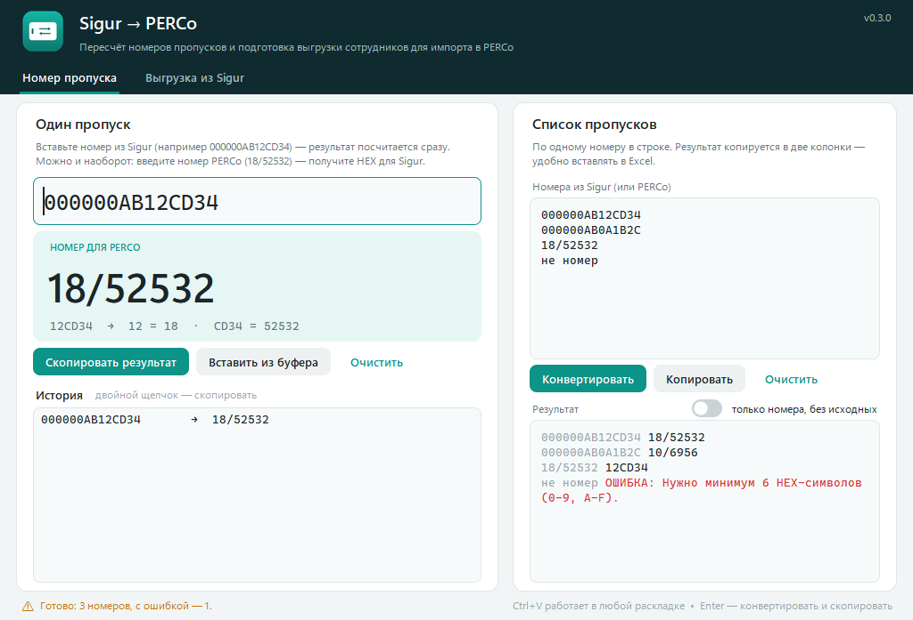
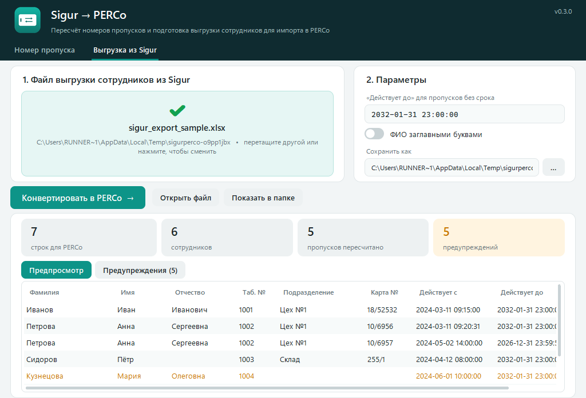

<p align="center">
  
</p>

<h1 align="center">Sigur → PERCo</h1>

<p align="center">
  Пересчёт номеров пропусков из Sigur в формат PERCo и подготовка выгрузки сотрудников для импорта в PERCo-Web.
</p>

<p align="center">
  <a href="https://github.com/uproxe/SigurToPerco/actions/workflows/build.yml"></a>
  
  
  <a href="LICENSE"></a>
</p>

<p align="center"><sub>
  <b>English:</b> a desktop tool that converts Sigur access card numbers (W58 HEX) to PERCo “series/number”
  format and turns a Sigur employee export into a PERCo-Web import table. Windows, Linux, macOS.
</sub></p>

<p align="center">
  
  
</p>

## Возможности

**Вкладка «Номер пропуска»**
- Скопировали номер в Sigur → нажали `Ctrl+V` в программе → номер для PERCo уже посчитан **и лежит в буфере обмена**.
- Работает и обратно: `18/52532` → `12CD34` (хвост номера в Sigur).
- Список номеров разом: результат копируется двумя колонками и ровно ложится в Excel.
- История пересчётов, `Ctrl+C / Ctrl+V` работают и в русской раскладке, меню по правой кнопке мыши.

**Вкладка «Выгрузка из Sigur»**
- Перетащите в окно выгрузку сотрудников из Sigur (`.xls` / `.xlsx`) — рядом появится `userPERCO_<дата>.xlsx`, готовый для импорта в PERCo-Web.
- В файле только таблица: заголовки в первой строке, сотрудники со второй (служебные строки отчёта импорт не принимает).
- Предпросмотр, сводка и предупреждения: нет отдела, не разобрался номер, задвоенная карта, заблокированные пропуска и т.п.
- Несколько пропусков у одного человека → по строке на каждый пропуск.

## Скачать

Готовые сборки — на странице **[Releases](https://github.com/uproxe/SigurToPerco/releases/latest)**:

| Система | Файл |
|---|---|
| Windows 10/11 | `SigurPerco-…-windows-x64.exe` — запустить, установка не нужна |
| Windows 7 | `SigurPerco-…-windows-x64-win7.exe` |
| Ubuntu / Debian / Mint / Astra | `sigur-perco_…_amd64.deb` → `sudo apt install ./sigur-perco_…_amd64.deb` |
| Другой Linux | `SigurPerco-…-linux-x64.tar.gz` — распаковать и запустить |
| macOS Apple Silicon / Intel | `SigurPerco-…-macos-arm64.dmg` / `…-macos-intel.dmg` |

> **macOS:** программа не подписана сертификатом Apple. При первом запуске: «Системные настройки →
> Конфиденциальность и безопасность → Всё равно открыть», или в Терминале
> `xattr -dr com.apple.quarantine /Applications/SigurPerco.app`.

## Как пересчитывается номер

Sigur показывает номер карты в HEX (формат W58), PERCo — как «серия/номер» (Wiegand-26: код объекта 0–255 и номер 0–65535).

```
Sigur:   000000AB12CD34
         последние 6 знаков              12CD34
         серия = HEX→DEC первых двух     12   → 18
         номер = HEX→DEC следующих 4     CD34 → 52532
PERCo:   18/52532
```

## Соответствие колонок

| Sigur | PERCo |
|---|---|
| Имя (Ф И О через пробел) | Фамилия, Имя, Отчество |
| Таб. № | Табельный номер |
| Отдел | Подразделение |
| Должность/модель | Должность |
| Номер пропуска | Карта № (пересчитывается) |
| Время выдачи | Действует с, Дата приёма на работу |
| Срок действия | Действует до («не ограничен» → значение из настроек, по умолчанию `2032-01-31 23:00:00`) |
| Режим «…блок…» | Блокировка = Да |

Остальные колонки PERCo остаются пустыми, «Биометрия» = 0. Переносятся только записи с типом «Сотрудник».

---

## Для разработки

### Структура проекта

```
sigur_perco/
  core.py          ← вся логика: пересчёт номеров, чтение выгрузки, запись файла PERCo
  gui.py           ← окно программы (tkinter)
  widgets.py       ← современные элементы: скруглённые кнопки и поля, тонкий скроллбар, переключатели
  __main__.py      ← запуск: окно или командная строка
  __init__.py      ← версия программы
run.py             ← точка входа (python run.py) и для PyInstaller
tests/             ← тесты (pytest) и генератор вымышленной выгрузки
examples/          ← пример выгрузки Sigur с вымышленными данными
assets/            ← значки (ico / icns / png)
docs/screenshots/  ← скриншоты для README
scripts/
  build.py         ← сборка под текущую систему: exe / deb / dmg
  screenshots.py   ← запустить окно, прокликать вкладки и сохранить скриншоты
  release_notes.py ← описание релиза из CHANGELOG и проверка версии перед выпуском
  make_icons.py    ← перерисовать значок
  make_sample.py   ← пересоздать пример выгрузки
packaging/linux/   ← ярлык и описание .deb-пакета
pyproject.toml     ← описание пакета, настройки pytest и ruff
.github/           ← сборка в GitHub Actions, Dependabot, шаблоны issue и pull request
```

Настройки конвертации (срок «не ограничен», ФИО заглавными, какие типы записей переносить, шаблон доступа)
— константы в начале [`sigur_perco/core.py`](sigur_perco/core.py). Цвета интерфейса — словарь `C` в начале
[`sigur_perco/gui.py`](sigur_perco/gui.py).

### Запуск из исходников

```bash
python -m pip install -r requirements-dev.txt
python run.py                                    # окно
python run.py examples/sigur_export_sample.xlsx  # окно, файл сразу сконвертирован
python run.py --card 000000AB12CD34              # → 18/52532
python run.py --cli выгрузка.xls -o userPERCO.xlsx
```

На Linux для окна нужен tkinter: `sudo apt install python3-tk`. Можно и поставить как пакет:
`pip install .` — появится команда `sigur-perco`.

### Проверки

```bash
python -m ruff check .              # стиль и типичные ошибки
python -m pytest                    # логика: пересчёт номеров, чтение и запись файлов
python scripts/screenshots.py       # окно «вживую»: прокликивает вкладки, снимки в screenshots/
```

### Сборка у себя

| Система | Команда | Результат в `release/` |
|---|---|---|
| Windows | `build.bat` | `.exe` |
| Linux | `./build.sh` | `.deb` и `.tar.gz` |
| macOS | `./build.sh` | `.dmg` |

PyInstaller собирает только под ту систему, на которой запущен, — поэтому все версии сразу делает GitHub Actions.

### GitHub Actions

Workflow [`.github/workflows/build.yml`](.github/workflows/build.yml):

- **push в `main`** или **Actions → Build → Run workflow** — линтер, тесты, проверка окна и сборки под все системы;
  файлы — в разделе *Artifacts* на странице запуска;
- **push тега `vX.Y.Z`** — то же самое плюс **Release** со всеми файлами и описанием из `CHANGELOG.md`;
- **pull request** — линтер, тесты и проверка окна.

Проверка окна запускает программу на виртуальном экране и сохраняет скриншоты в артефакты `ui-screenshots-*`.

### Выпуск версии

Поменять `__version__` в `sigur_perco/__init__.py`, описать изменения в `CHANGELOG.md`, затем:

```bash
git tag -a v0.4.0 -m "Sigur → PERCo 0.4.0"
git push origin main v0.4.0
```

Подробнее — в [CONTRIBUTING.md](CONTRIBUTING.md). Сборка остановится, если тег не совпадает с версией в коде
или в CHANGELOG нет раздела для неё.

> Репозиторий приватный: минуты macOS в бесплатном лимите GitHub считаются ×10, Windows ×2.
> Чтобы не тратить их на каждый push, уберите `branches: [main, master]` из `on.push` — сборки останутся на теги и ручной запуск.

---

*Sigur и PERCo — торговые марки их владельцев. Проект не связан с производителями и использует только формат
выгружаемых и загружаемых файлов.*

Лицензия: [MIT](LICENSE).
